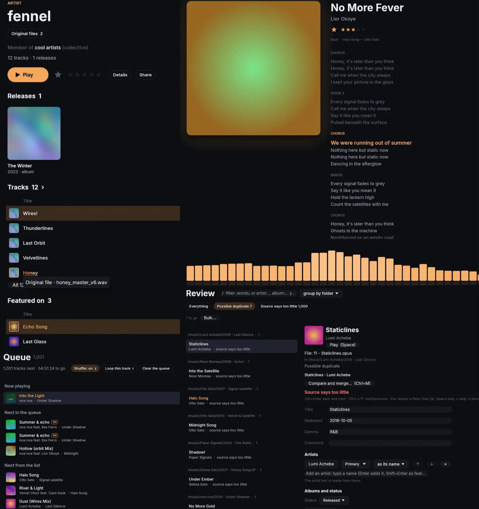
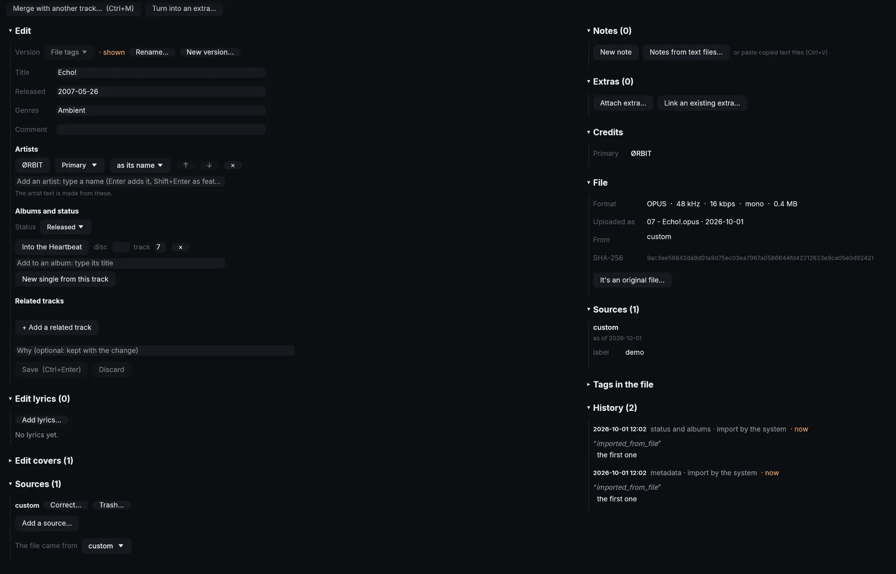
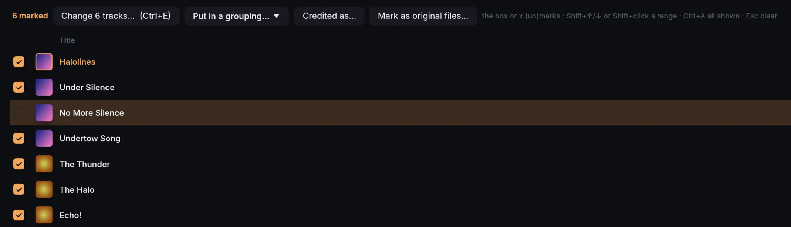
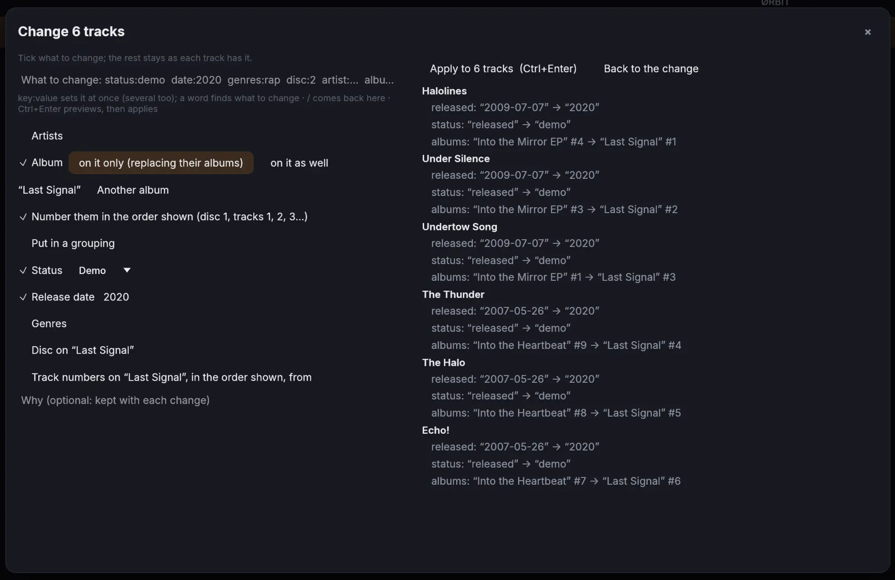
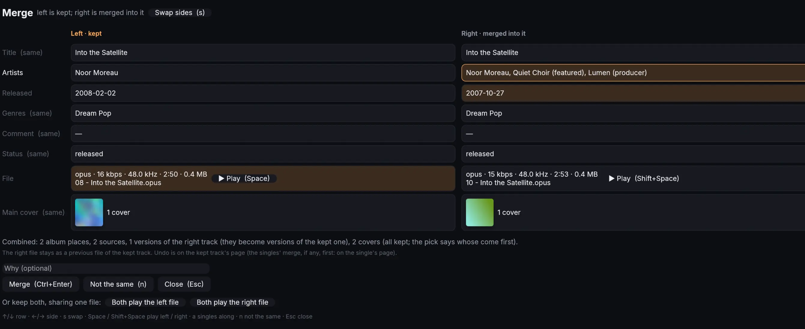
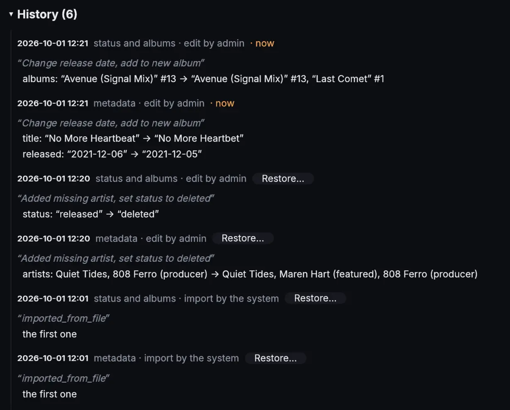
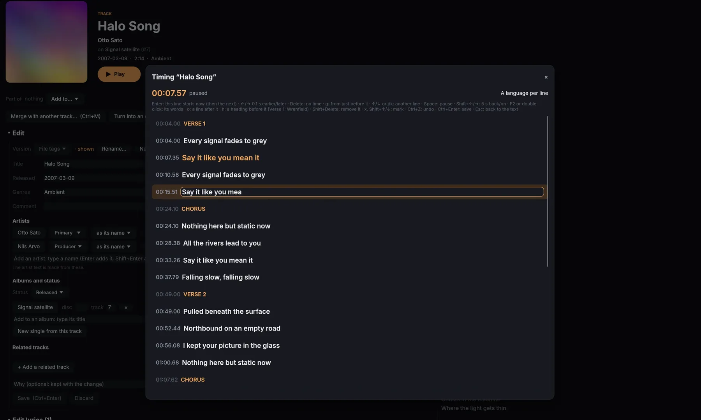

# Acetate
<p align="center"></p>

### The only self-hosted music server you will ever need. For true power users and archivists.

<p align="center"></p>

---
## What can it do?
**Acetate has all features as any other music player (except better)**
- Rating tracks, queue system, searching, playlists, gapless playback... the usual
- Synced lyrics
- Audio visualizer
- Play count tracking
- Keyboard controls for everything

**That's not where it stops, it has LOTS of features literally nothing else has:**
- The full library metadata is synced locally - **searches are instant and work fully offline**. Full syncs take seconds.
- Indicators for **original files**, their filenames, etc.
- Built in support for **music videos**
- Tracks **link** together (A is a remix of B and so on)
- **Fully native cross-platform desktop app (egui)** - it's clean and fast. Simple web UI is included, but it's not the preferred way to use Acetate.
- Python library for custom ingestion scripts, tailor it to your specific library setup

**There's an entire [feature rich edit mode](#edit-mode) too**


## How does it do all this?? Why doesn't my (old) favorite server/client do this??

Existing self-hosted music servers (Navidrome, Jellyfin, etc.) treat audio files as the source of truth. A scanner reads embedded tags and builds the library from them. That model has many downsides and makes a whole class of features impossible:

- Same track must have **duplicate files** if it appears on multiple albums, wasting disk space
- Editing metadata means **rewriting files**, which is **slow**, touches the audio, and has to be synced to every device holding a copy.
- There is **nowhere to store information that tags can't hold**: where a file came from, release status, metadata history...
- Artists are just strings, **ambiguity is obvious** and aliases are awkward.
- Generic schemas built to serve many use cases produce queries that are **slow at scale and hard to fix**.
- **Bulk fixes**, like changing an artist name, are not straightforward.

Acetate fixes all of that: **files are immutable blobs; all metadata lives in the database.** Edits are instant across all tracks and visible to users immediately. Tags are read once at import and never written back. You don't need your files to have tags to import them, but it's useful for "refugees" migrating.

## Edit mode
When listening, you won't accidentally change something you didn't mean to; advanced knobs and tweaks stay out of your way. For those, enable **Edit mode, where things get advanced**


- **Edit metadata** for album, tracks... all of it
- **Status can be marked** unreleased, deleted, unfinished etc.
 
  
  
- Mark albums as **singles, EP, mixtape**... or your custom values!
- **Aliases for artists** - insanely useful when artists release under multiple names, but you want their tracks in one place
- **Group** tracks, album, and artists under whatever you want: collective, label, era, project...
- **Notes** for tracks, albums, and artists - leave extra detail that doesn't fit elsewhere
- Link "extra" files to them, **music videos, stems, samples...** anything you want
- **Bulk editing tools** for everything - metadata, aliases, release status, year. Automatic title parsing tools included
  
  

- **Merge tracks, albums, and artists together** - metadata of both of them stay as versions. Track and album merges can be undone
  
**Other features which make Acetate the ultimate choice**
- Fine grained **permission control** for users, you control exactly what they can access
	- Upload files, edit metadata, share... and so on
	- Even **restrict certain tracks** from users
- EVERYTHING has a **history**, all changes are logged and almost all can be reverted

  

- **Share** with your friends! If they're logged in, they can see it straight from the app; if not, the web version will do just fine
- Built in **synced lyric editor** - supports headers like [Intro] and [Verse 1: Artist] - even in synced lyrics!

<p align="center"></p>

- **Artists have IDs and disambiguation**. Supporting multiple artists with the same name is a given

## Can you trust Acetate with your library?

**Yes**. I personally daily-drive Acetate and everything just works. Simple Navidrome-like experience works out of the box, but to really get the most out of your library there is a skill curve. Your mileage may vary based on your technical abilities, if you want the maximal amount of control (e.g. custom ingestion scripts via the Python library). Development stage is early, but Acetate can already handle almost everything you will need.

## Install

The user guide is at <https://allinen.github.io/acetate/> (its source is `docs/`).

Acetate runs as two containers: Postgres and the server. The image is published at `ghcr.io/allinen/acetate` (amd64 and arm64), so you only need the `deploy` folder:

```sh
git clone https://github.com/Allinen/acetate.git && cd acetate/deploy
cp .env.example .env        # set POSTGRES_PASSWORD, POSTGRES_DATA and DISK (where your music lives)
docker compose up -d
docker compose exec acetate acetate user create admin --group admin   # asks for a password
```

Then bring your music in. Paths are as the container sees them, so with `DISK=/srv/media`, `/srv/media/Music` is `/disk/Music`:

```sh
docker compose exec acetate acetate ingest /disk/Music --layout tags --origin my-library --dry-run
```

Drop `--dry-run` once the output looks right. Keep your music on the same mount as Acetate's volume: imports are then reflinks, which are instant and take no extra space (on btrfs, XFS, or ZFS with block cloning; anywhere else the files are copied).

**Clients:** the desktop app for Linux and Windows is on the [releases page](https://github.com/Allinen/acetate/releases). To build it yourself, run `clients/desktop/install.sh`. The web UI is at `http://<your-server>:3000`, but you'll most likely not need it.

## Non-goals

- **No Subsonic / OpenSubsonic API.** No existing client can display the features above, so compatibility isn't worth the cost. Acetate ships its own clients.
- **No writing tags to files or modifying them.** Ever. Downloads may get current tags injected into the *stream*, but the stored file is untouched.
- **No filesystem scanning as the main ingest path.** Files come in through upload or API, not by watching a music folder.
- Not trying to be a general-purpose media server (no podcasts, audiobooks, films). Music videos are kept only as extras of songs.
- Nothing that I personally don't need, it's purely designed for me so far. If this gains traction, I can implement other stuff too.

## FAQ
- Can I have multiple versions of metadata for the same track? 
	- Yessir
- Will it delete my songs or mess them up?? 
	- No, you can even mount as read-only and everything works fine
- How do I organize my library if theres no folders and filenames!? 
	- Yeah you don't need that - everything you could possibly do with a folder structure can be done on Acetate.
- Can I save space by playing the same audio track if it's on multiple albums? 
	- You betcha
- Can somebody wipe metadata and it's gone for good? 
	- Nope! Either don't give permissions or revert the changes. Remember to always take backups
- Does it support multiple covers per track? 
	- You already know it
- How fast is it?? 
	- Speed is the core of Acetate. It's so fast, you won't ever need anything faster. Your catalogue is loaded into memory, so you don't even need to query the server. 
- Where are my songs?? 
	- `data/blobs/ab/cd/abcd1234...`   full sha256 as filename, no extension
- What if I want to save my songs on multiple drives?
	-  blobs can be spread over several disks, e.g. a fast SSD for most music and a big HDD for the less important part. `ACETATE_VOLUMES=main=/srv/acetate,archive=/mnt/hdd/acetate` names them (each gets `blobs/` and `tmp/`); the first is the default. Without it there's one volume, `main`, in `ACETATE_DATA_DIR` (default `./data`).
- Ok but I don't have enough space to keep my old library and then this blob stuff
  - Imports from the same filesystem are reflinks - your migration will not take up any extra space and it's really fast. No reason to not give it a try!
  - Ermm actually I use the "REALBESTARTISTFIELD" tag for metadata, I bet this doesn't support it!!
    - Probably not. The tags are still kept and viewable, so if you want to see your weird tags you can. If no native integration is heartbreaking, open a PR :)
  - What is this "original filename" stuff and OG files?
    - Original "studio" files for audio, for those of us who enjoy that pristine quality. FLAC and other lossless rips do not count. If you *think* you have an OG file, you don't. You have to **know** 
- I just got a higher quality version of a track already in my library, can I replace it?
	- Absolutely. The old file also stays behind, unless an admin wants to purge it (there's a cooldown period)

### Moving over from Navidrome

1. Ingest your tracks into acetate with `acetate ingest`.
2. Import navidrome users, plays, start and ratings with `acetate import-navidrome --db navidrome.db --path-map /navidrome/music=/acetate/music" [--dry-run]`
3. There's no third step
- **Users:** each becomes an Acetate user with the same username (admins in the `admin` group, the rest in `user`).
- **Matching is by path, then content:** Imports are fast if the paths match (why wouldn't they?) and relocated files aren't skipped. Anything unsure is reported, not guessed.
- **Playlists:** normal playlists are imported. Smart playlists are not yet implemented. 

### Trash and purge

- **Nothing is deleted directly.** Covers need `edit_metadata`, sources need `edit_sources` and old audio files are admins only. They go to the trash first and can be taken back out.
- **Purging is the only deletion, and it's deliberate:** admins only, only for things at least 7 days in the trash AND with a typed confirmation checked by the server. Enough to stop accidents, not enough to make regular cleanups tedious.
- **Audio files:** Purging a track deletes its bytes but keeps its row as a tombstone: its tags, origin and place in the track's history stay. Uploading the same bytes again later stores them as a new file.
- **Blobs are deleted only when nothing uses them anymore** (a copied cover shares its blob), checked across the whole library, and only after the database transaction has committed: a crash in between can leave a stray blob, never a row whose blob is gone.
- **Every purge is logged** in `purge_log` and has who, when, what it was, bytes freed; readable by admins only.


## Development

```sh
docker compose up -d                 # Postgres 18 on 127.0.0.1:5432
cp .env.example .env
cargo run -- user create alice --group admin   # asks for a password (or --password-stdin)
cargo run -- serve                   # runs migrations, serves on 127.0.0.1:3000
                                     # open http://127.0.0.1:3000 for the web UI in web/
scripts/install-hooks.sh             # pre-commit: versions agree, generated docs current; pre-push: clippy
```

The server, the apps and the Python library share one version: `scripts/versions.py` checks that every place that has it agrees, and `scripts/versions.py --set 0.2.0` changes them all (then tag `v0.2.0` to release; the tag has to match). `API_VERSION` and `CATALOG_FORMAT` are numbers the server and the apps are all built with: bump them when a change would break an app that doesn't have it.

`sqlx::query!` checks SQL against the live database at compile time, so Postgres must be running to build.
Reset the dev database with `scripts/reset-dev-db.sh`: empties it, reapplies the migrations and creates the user `admin` (password `adminadmin`); `--with-audio` also imports `./test-audio`. It only touches local databases whose name ends in `_dev`, `_test` or `_scratch` (so never the real library, e.g. `acetate`), and works while psql or the server is connected (restart the server afterwards).

Bring a local database up to date with `scripts/migrate-db.sh` (after pulling new migrations, say): it applies the migrations that haven't run yet and nothing else. A plain `cargo build` fails while the database is behind (sqlx checks the queries against it); the script uses `sqlx migrate run` when sqlx-cli is installed, else builds against the checked-in query cache (`.sqlx`). `acetate migrate` does the same with a built binary.

## License
[GPL-3.0](LICENSE)
